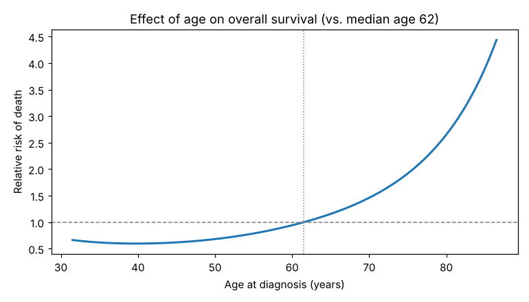

# Predicting Overall Survival in Breast Cancer Patients Using Cox Proportional Hazards Regression

[](https://captstoneproject-qeani92jxftayhyhl4f3qu.streamlit.app/)

A Cox proportional hazards model that predicts overall survival for breast cancer patients from clinical information available at diagnosis, with a web app for individual patient predictions.

**Live app:** https://captstoneproject-qeani92jxftayhyhl4f3qu.streamlit.app/

Enter a patient's age, tumor size, positive lymph nodes, histologic grade and ER status to see their predicted 5-year and 10-year survival, median survival, and survival curve up to 20 years.

## Data

The METABRIC breast cancer cohort (clinical data from cBioPortal, study `brca_metabric`).

- 2,509 patients in the file; 1,793 remain after removing patients with missing survival or predictor data
- Outcome: **overall survival**, meaning death from any cause is the event and living patients are censored at last follow-up
- 1,029 deaths (57.4%)

## Model

| Variable | How it enters the model | Why |
|---|---|---|
| Tumor size (mm) | Linear term | Meets the proportional hazards assumption |
| Positive lymph nodes | Linear term | Meets the proportional hazards assumption |
| Age at diagnosis | Spline (4 degrees of freedom) | A straight-line age effect violated the assumption; the spline lets the effect curve |
| ER status (IHC) | Stratification variable | Violated the assumption; each ER group gets its own baseline survival curve |
| Histologic grade | Stratification variable, grouped as grade 3 vs. 1–2 | Violated the assumption; grouping keeps every stratum large enough (smallest: 45 patients) |

All terms pass the Schoenfeld residual test for proportional hazards. One age spline component is borderline on the KM time scale only (p = 0.0505).

## Validation

1. **80/20 train/test split**, stratified on the event so both sets have the same death rate (random seed 42).
2. **5-fold cross-validation** on the training set only, used for all modeling decisions.
3. **One final evaluation** on the held-out test set.

| | C-index |
|---|---|
| 5-fold cross-validation (training set) | 0.676 ± 0.022 |
| Held-out test set | 0.665 |

The C-index is scored with each patient's predicted 10-year survival as the risk score. lifelines' built-in score uses only the partial hazard, which ignores the strata and under-scores stratified models.

## Results

Hazard ratios from the final model (fit on the 1,434 training patients):

| Variable | Hazard ratio (95% CI) | Meaning |
|---|---|---|
| Tumor size | 1.008 per mm (1.005–1.012) | about 8% higher risk per extra centimeter |
| Positive lymph nodes | 1.078 per node (1.062–1.094) | about 8% higher risk per extra positive node |

Age, ER status and grade have no single hazard ratio because of how they enter the model. Age's effect is shown as a curve instead:



Risk is roughly flat before age 50 and rises steeply after 60. An 80-year-old has about 2.6 times the risk of a patient at the median age of 62.

## Repository

| Path | Contents |
|---|---|
| `app.py` | Streamlit app: loads the data, fits the final model, and serves predictions |
| `requirements.txt` | Python packages the app needs |
| `data/brca_metabric_clinical_data.tsv` | METABRIC clinical data |
| `figures/age_effect.png` | Age effect plot used above |
| `.devcontainer/` | Configuration for running the app in GitHub Codespaces |

## Run the app locally

```
pip install -r requirements.txt
streamlit run app.py
```

The app opens at `http://localhost:8501`.

## Limitations

- The model ranks patients' survival correctly about two times in three (C-index 0.665 on unseen patients). It uses only five clinical variables; treatment, HER2 and PR status are not included.
- Predictions stop at 20 years because few patients were followed longer.
- METABRIC patients were diagnosed between 1977 and 2005, so treatment has changed since. Predictions reflect that historical cohort.
- This is a student capstone project, not a clinical tool.

## Acknowledgments

The approach to proportional hazards violations (stratifying categorical variables, splines for continuous ones) follows the analysis in [juliettebm/METABRIC-Breast-Cancer-Survival-Analysis-Machine-Learning](https://github.com/juliettebm/METABRIC-Breast-Cancer-Survival-Analysis-Machine-Learning).
