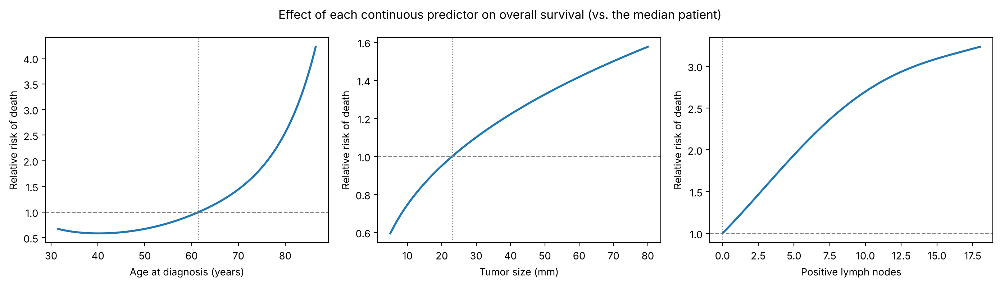

# Predicting Overall Survival in Breast Cancer Patients Using Cox Proportional Hazards Regression

[](https://breast-cancer-overall-survival-cox-nwganxk3fs5q3gargnbappm.streamlit.app/)
[](https://colab.research.google.com/github/abdulksidani-png/breast-cancer-overall-survival-cox/blob/main/notebooks/cox_overall_survival.ipynb)

A Cox proportional hazards model that predicts overall survival for breast cancer patients from five clinical variables known at diagnosis, with a web app for individual patient predictions. Every modelling choice is tested in the notebook or supported by published research.

**Live app:** https://breast-cancer-overall-survival-cox-nwganxk3fs5q3gargnbappm.streamlit.app/

Enter a patient's age, tumor size, positive lymph nodes, histologic grade and ER status to see their predicted 5-year and 10-year survival, median survival, and survival curve up to 15 years.

## Analysis notebook

[`notebooks/cox_overall_survival.ipynb`](notebooks/cox_overall_survival.ipynb) walks through the full analysis in order. Each step explains the reasoning and its source, runs the code, and interprets the result:

1. Data and outcome
2. Missing data
3. Train/test split and validation plan
4. Choosing the predictors
5. Starting model and the proportional hazards check
6. ER status and grade as strata
7. How the model is scored
8. The shape of each continuous predictor
9. How flexible the splines should be
10. Final model
11. Re-checking proportional hazards
12. Test set
13. How stable the test score is
14. What the model says about each predictor
15. How far ahead the model can predict
16. Patient prediction form
17. Conclusions and limitations
18. References

## Data

The METABRIC breast cancer cohort (Curtis et al., 2012), clinical data from cBioPortal (study `brca_metabric`). Tumors were collected between 1977 and 2005.

- 2,509 patients in the file; 1,793 remain after removing patients with missing survival or predictor data
- Patients with a missing predictor have the same survival as complete patients (HR 1.05, p = 0.63), which supports complete-case analysis
- Outcome: **overall survival**, meaning death from any cause is the event and living patients are censored at last follow-up
- 1,029 deaths (57.4%)

## Model

| Variable | How it enters the model | Evidence (notebook section) |
|---|---|---|
| ER status (IHC) | Stratum | Violated proportional hazards (5) |
| Histologic grade | Stratum, grouped as grade 3 vs. 1–2 | Violated proportional hazards (5); grouping keeps every stratum at 45+ patients (6) |
| Age at diagnosis | Spline, 4 degrees of freedom | Linear age violated proportional hazards and fit worst (5, 8); 4 df is the simplest spline that passes (9) |
| Tumor size (mm) | Log scale | Fit better than linear and as well as a spline, with fewer parameters (8) |
| Positive lymph nodes | Spline, 3 degrees of freedom | Fit best (8); 3 df is the most the data supports (9) |

The final model passes the proportional hazards test for every term.

## Validation

1. **80/20 train/test split**, stratified on the event so both sets have the same death rate (random seed 42).
2. **5-fold cross-validation** on the training set only, used for every modelling decision.
3. **One final evaluation** on the held-out test set.

| | C-index (10-year survival) | C-index (partial hazard) |
|---|---|---|
| 5-fold cross-validation | **0.680 ± 0.023** | 0.664 ± 0.027 |
| Held-out test set | **0.674** | 0.650 |

The main C-index ranks patients by predicted 10-year survival, because lifelines' built-in version uses only the partial hazard and ignores the strata. Both versions are reported. Across 30 different random splits, the test C-index ranges from 0.650 to 0.713 (mean 0.683).

## Results

- **Tumor size:** each doubling raises the risk of death by about 29%.
- **Age:** risk is roughly flat until the 50s, then rises steeply. A 70-year-old has 1.44 times and an 80-year-old 2.55 times the risk of a median patient (61.5 years).
- **Lymph nodes:** risk rises steeply over the first ~10 positive nodes, then levels off. 1 node gives 1.18 times the risk of 0 nodes, and 10 nodes 2.70 times.



## Repository

| Path | Contents |
|---|---|
| `notebooks/cox_overall_survival.ipynb` | Full analysis, from data cleaning to the final model and prediction form |
| `app.py` | Streamlit app: loads the data, fits the same final model, and serves predictions |
| `requirements.txt` | Python packages the app needs |
| `data/brca_metabric_clinical_data.tsv` | METABRIC clinical data |
| `figures/predictor_effects.png` | Effect plots shown above |
| `.devcontainer/` | Configuration for running the app in GitHub Codespaces |

## Run the app locally

```
pip install -r requirements.txt
streamlit run app.py
```

The app opens at `http://localhost:8501`.

## Limitations

- Internal validation only: the test set comes from the same cohort. External validation on a different cohort would be needed before any real use.
- METABRIC patients were diagnosed between 1977 and 2005, and treatment has improved since, so predictions reflect that historical cohort.
- Complete-case analysis dropped 187 patients with a missing predictor; multiple imputation could add statistical power.
- Grouping grades 1 and 2 was needed for stable strata, but it loses the difference between them.
- Calibration (whether predicted probabilities match observed survival) was not assessed.
- HER2 and PR status and treatment are not in the model.
- This is a student capstone project, not a clinical tool.

## Acknowledgments

The approach to proportional hazards violations (stratifying categorical variables, splines for continuous ones) follows the analysis in [juliettebm/METABRIC-Breast-Cancer-Survival-Analysis-Machine-Learning](https://github.com/juliettebm/METABRIC-Breast-Cancer-Survival-Analysis-Machine-Learning). Full references for every methodological choice are in section 18 of the notebook.
